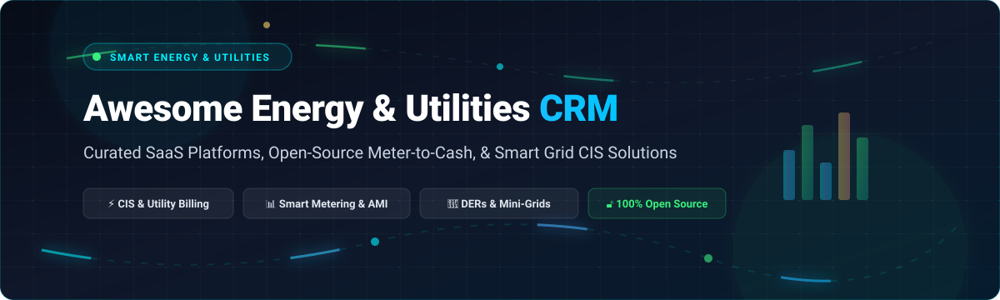

# Awesome Energy & Utilities CRM ⚡

  

  
  
  
  
  
  

  <strong>A curated list of awesome Energy &amp; Utilities CRM platforms, meter-to-cash customer information systems (CIS), AMI smart metering infrastructure, distributed energy resource (DER) billing engines, and open-source mini-grid management tools.</strong>

---

## 🧭 Table of Contents

- [📊 Sector Overview & Market Dynamics](#-sector-overview--market-dynamics)
- [🏢 SaaS & Hosted Enterprise Platforms](#-saas--hosted-enterprise-platforms)
- [🔓 Open-Source GitHub Projects](#-open-source-github-projects)
- [🛠️ Utility CRM Architecture & Stack Guide](#️-utility-crm-architecture--stack-guide)
- [🤝 How to Contribute](#-how-to-contribute)
- [💖 Support](#-support)
- [⭐ Star History](#-star-history)
- [⚖️ Disclaimer](#️-disclaimer)

---

## 📊 Sector Overview & Market Dynamics

The global **Energy & Utilities Customer Information System (CIS) and CRM market** is valued between **$2 billion and $10 billion** (projected to scale past **$20 billion** by the 2030s, driven by smart metering, distributed energy resource (DER) adoption, EV charging networks, and grid modernization initiatives).

The sector is **moderately fragmented**: while legacy enterprise titans (**Oracle**, **SAP**, and **Salesforce**) dominate large investor-owned utilities (IOUs), regional regulatory variations, retail energy deregulation, and modern composable cloud architectures have fostered specialized high-growth mid-market competitors and digital customer-engagement platforms.

---

## 🏢 SaaS & Hosted Enterprise Platforms

| Platform | Company Size (Revenue / Valuation) | Pricing | Free Tier / Trial Limit | Description |
| :--- | :--- | :--- | :--- | :--- |
| **[Oracle Utilities Customer Cloud](https://www.oracle.com/utilities/)** | **~$415B–$440B Valuation** (~$57B–$67B FY25/26 Rev) | Tiered SaaS from **$1.00 – $3.00/billable customer/month** (enterprise subscription base) | **30-day trial** via Oracle Cloud Free Tier ($300 cloud credits; production CCS requires sales-provisioned PoC sandbox) | Comprehensive customer information system (CIS) and billing platform for utilities. Features meter-to-cash processing, customer self-service, and integration with Oracle Utilities applications. |
| **[SAP for Utilities](https://www.sap.com/industries/utilities.html)** | **~$220B–$245B Valuation** (~€37B–€38B+ FY25/26 Rev) | Entry RISE/Cloud packages from **~$2,000 – $5,000/FUE/year** (or volumetric Point of Delivery rates) | **30-day free trial** for SAP Cloud for Energy / S/4HANA Cloud (guided tour with sample utility data; extendable up to 90 days on SAP BTP) | Enterprise solution for utility customer management, billing, and device management. Integrated with SAP S/4HANA for financial and operational processes. |
| **[Salesforce Energy and Utilities Cloud](https://www.salesforce.com/energy-utilities/)** | **~$185B–$200B Valuation** (~$41.5B FY26 Rev) | Starting at **$350/user/month** (Starter Core) up to **$650–$700/user/month** (Service Max) | **30-day free trial** (pre-configured environment with sample utility data and guided workflows; no credit card required) | Purpose-built CRM for utilities and energy companies. Features Industries CPQ for rates and pricing, OmniStudio for guided workflows, Smart Utility Contact Centre, clean energy program management, and field service for utilities. |
| **[Uplight](https://uplight.com/)** | **$1.5B Valuation** (~$100M+ ARR) | Modular subscriptions starting from **$10,000/year** (custom-scoped utility base packages) | **14 to 30-day guided evaluation pilot / sandbox** upon request (no self-serve free-forever tier) | Customer energy engagement platform. Features personalized energy insights, demand response, and marketplace solutions for utilities. Backed by Schneider Electric and Octopus Energy. |
| **[Hansen Technologies](https://www.hansencx.com/)** | **~A$690M–$700M Market Cap** (~A$386M Annual Rev) | Modular enterprise CIS/billing deployments from **A$100,000+/year** (or A$0.50–$2.00/meter/year) | **Custom 30-day proof-of-concept (PoC)** environment for qualified utility operators (no public free tier) | Customer care and billing solutions for utilities and telecommunications. Features revenue management, meter data management, and customer engagement. |
| **[Gentrack](https://www.gentrack.com/)** | **~NZD $410M–$460M Market Cap** (~NZD $220M–$230M Annual Rev) | Custom deployment baseline starting from **NZ$500,000** (one-time deployment tier + recurring SaaS) | **Interactive guided product demo / 30-day pilot sandbox** arranged via sales (no self-serve free tier) | Utility billing and customer care platform. Features billing, CRM, meter data management, and market interaction for energy retailers. |
| **[VertexOne](https://www.vertexone.net/)** | **~$200M+ Valuation** (~$150M–$160M Annual Rev) | Directory baseline starting at **$1.00/user/month** (enterprise CIS contracts scale by connection/meter count) | **14 to 30-day utility proof-of-concept (PoC)** upon enterprise qualification (no public free tier) | Customer information system and billing platform for utilities. Features billing, CRM, and customer self-service supporting 400+ utilities. |
| **[SEW Smart Customer Mobile](https://www.sew.ai/)** | **~$100M–$150M Valuation** (~$50M–$80M ARR) | Private enterprise offers starting from **$25,000–$50,000/year** (scaled by customer connection volume) | **30-day enterprise pilot / staged demo sandbox** upon request via AWS Marketplace / direct sales (no public free tier) | Digital customer engagement platform for utilities. Features mobile app, self-service portal, and omnichannel communication. |
| **[Fluentgrid](https://www.fluentgrid.com/)** | **~₹700M–₹1,000M Valuation** (~₹200M–₹220M Annual Rev) | Modular packages starting from **₹500,000+/year** (~$6,000/year base depending on consumer footprint) | **30-day tailored proof-of-concept / demo sandbox** for municipal and regional utilities (no public free tier) | Smart utility solutions including customer management, billing, and field service management. |
| **[Agility CIS](https://www.agilitycis.com/)** | **~$150M–$200M Valuation** (Tally Group / SilverTree PE; ~$25M–$40M Rev) | Tiered meter/retailer baseline starting from **$30,000/year** (custom volumetric rates per consumer) | **30-day guided proof-of-concept / demo access** upon sales consultation (no public free tier) | Customer information system for energy and utility retailers. Features billing, CRM, and market operations. |

---

## 🔓 Open-Source GitHub Projects

Curated open-source projects for self-hosted utility management, meter-to-cash billing, smart grid IoT, DLMS/COSEM meter data exchange, and PAYGO mini-grid operations, **sorted by GitHub Stars_Count (descending)**:

| Project | GitHub_Stars | Focus / Category | Tech Stack | Highlights |
| :--- | :--- | :--- | :--- | :--- |
| **[Kill Bill](https://github.com/killbill/killbill)** |  | Subscription & Utility Billing Engine | Java, MySQL / PostgreSQL | Industrial open-source recurring billing and payment engine suitable for energy retailers, utility account cycles, and complex rating models. |
| **[InvoicePlane](https://github.com/InvoicePlane/InvoicePlane)** |  | Self-Hosted Invoicing & Client Portal | PHP, MySQL | Lightweight open-source client management and recurring billing tool for municipal utilities, local cooperatives, and service providers. |
| **[OpenRemote](https://github.com/openremote/openremote)** |  | Smart Grid IoT & Energy Asset Management | Java, TypeScript, Docker | 100% open-source IoT platform for smart city energy distribution, smart meter asset telemetry, automated rule engines, and fleet integration. |
| **[OpenEMS](https://github.com/OpenEMS/openems)** |  | Modular Energy Management System | Java, OSGi, Angular | Comprehensive open-source energy management framework controlling battery storage systems (BESS), inverters, microgrids, and dynamic grid tariffs. |
| **[SteVe](https://github.com/steve-community/steve)** |  | EV Charging Station & CPO Management | Java, Spring Boot, MariaDB | Open-source OCPP server implementation for utility EV charging management, session metering, and charge-point operator (CPO) billing integration. |
| **[volkszaehler.org](https://github.com/volkszaehler/volkszaehler.org)** |  | Smart Meter Data Logger & Middleware | PHP, JavaScript, C | Open-source smart meter logging platform focused on data sovereignty and smart meter interface readout (SML, OBIS, D0, Modbus). |
| **[OpenPAYGO Token](https://github.com/EnAccess/OpenPAYGO-Token)** |  | PAYGO Token & Activation Protocol | C, Python, Go | Standardized open-source token system for pay-as-you-go solar home systems, mini-grid meters, and off-grid utility billing (EnAccess Foundation). |
| **[MicroPowerManager](https://github.com/EnAccess/micropowermanager)** |  | Mini-Grid CRM & Meter Management | PHP, Laravel, Vue.js, MySQL | Turnkey customer management and ticketing ERP for decentralized mini-grids. Integrates with Steamaco, Spark, Calin, and Stron smart meters. |
| **[OpenSmartMeter](https://github.com/EnAccess/OpenSmartMeter)** |  | Open GSM Smart Meter Hardware & Firmware | C++, Hardware Design (KiCad) | Low-cost open-source smart electricity meter with cellular connectivity (2G/4G/NB-IoT) for rural electrification, micro-utilities, and solar grids. |
| **[openMIC](https://github.com/GridProtectionAlliance/openMIC)** |  | Meter Information Collection System | C#, .NET, Web GUI | Enterprise utility meter interrogation engine by Grid Protection Alliance. Connects with DFRs, Modbus meters, and substations over IP/RAS. |
| **[Mwanzo Flats Management](https://github.com/Fredrickmureti/tenant-management-system)** |  | Tenant & Utility Sub-Meter Billing | TypeScript, React, Supabase | Sub-metering tenant portal with automated meter reading entry, utility balance computation, and self-service account management. |
| **[Metrify Smart Metering](https://github.com/kanhaiya-gupta/DataEngineering-metrify-smart-metering)** |  | Real-Time AMI Stream Pipeline | Python, Apache Kafka, Snowflake, Airflow | Production data engineering pipeline for streaming high-frequency AMI electricity meter readings, anomaly detection, and analytics. |

### 🧩 Specialized Utilities Libraries & Ingestion Tools

- **[dlms-bridge-mcp](https://pypi.org/project/dlms-bridge-mcp/)** — Bridges IEC 62056 DLMS/COSEM smart-meter protocols to AI agents and modern backends via Model Context Protocol (MCP).
- **[aemo-mdff-reader](https://pypi.org/project/aemo-mdff-reader/)** — Ultra-fast streaming reader for NEM12/NEM13 meter data file formats (MDFF), processing 2M+ readings/sec.
- **[oomi-influx](https://pypi.org/project/oomi-influx/)** — Headless ETL pipeline extracting 15-minute smart meter readings from Salesforce Experience Cloud into InfluxDB.
- **[Calin-Meter-Package](https://github.com/inensus/Calin-Meter-Package)** & **[Steama-Meter-Package](https://github.com/inensus/Steama-Meter-Package)** — Smart STS prepaid meter drivers for MicroPowerManager mini-grids.
- **[NeoBill](https://sourceforge.net/projects/solidstate/)** — High-performance GPLv2 web-based billing and customer management tool for regional utilities.

---

## 🛠️ Utility CRM Architecture & Stack Guide

To build a **100% vendor-independent, self-hosted Utility CRM stack**, combine:

1. **CRM & Account Management**: [MicroPowerManager](https://github.com/EnAccess/micropowermanager) or [Kill Bill](https://github.com/killbill/killbill)
2. **Smart Meter Ingestion & Telemetry**: [OpenRemote](https://github.com/openremote/openremote) or [volkszaehler.org](https://github.com/volkszaehler/volkszaehler.org)
3. **Data Pipeline & Timeseries Analytics**: Kafka + TimescaleDB / InfluxDB via [metrify-smart-metering](https://github.com/kanhaiya-gupta/DataEngineering-metrify-smart-metering)
4. **Tariff & Energy Dispatch**: [OpenEMS](https://github.com/OpenEMS/openems) for dynamic rate optimization and DER controls

---

## 🤝 How to Contribute

Contributions are warmly welcomed! Help keep this ecosystem comprehensive, factual, and up to date:

1. 🍴 **Fork the repository**
2. 🌿 **Create a feature branch** (`git checkout -b add-utility-platform`)
3. 📝 **Add your entry** (maintain alphabetical or sorted ranking, provide official links, and adhere to tabular schema)
4. 🚀 **Submit a Pull Request** with a concise description of why the tool belongs in this list

Please review our contribution guidelines and ensure all descriptions remain objective.

---

## 💖 Support

If you found this curated ecosystem helpful in your utility architecture or energy transition journey, please consider showing your support:

- ⭐ **Star this repository** to help others discover it
- 🍴 **Fork and share** with colleagues across the energy & utility tech community
- ☕ **Support the maintainer**: You can sponsor this project via the [GitHub Sponsors Dashboard](https://github.com/sponsors/ishandutta2007)

Thank you to all contributors and open-source utility innovators! 🙏

---

## ⭐ Star History

---

## ⚖️ Disclaimer

- This repository is a **community-curated index** provided for educational and architectural reference only. It does not constitute a formal commercial endorsement.
- Utility software handling customer identity (PII) and consumption data must comply with local privacy regulations (GDPR, CCPA) and critical infrastructure cybersecurity standards (NERC CIP, NIS2, IEC 62443).
- Always perform comprehensive security audits before deploying self-hosted billing and meter management systems in production.

---

  Maintained with ❤️ by the open energy community for utility operators, energy retailers, clean-tech engineers, and mini-grid builders worldwide.

